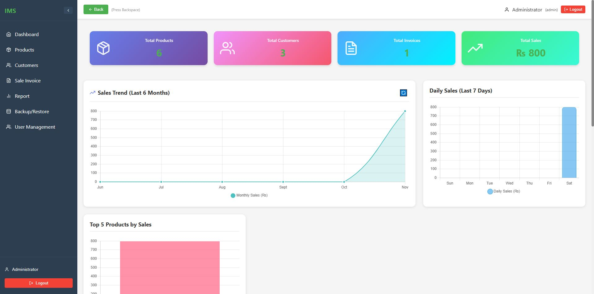
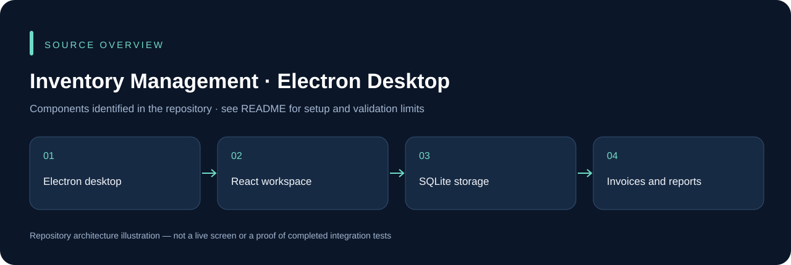

# Inventory Management · Electron Desktop

An Electron/React desktop application for inventory, customer accounts, invoices, reports and backup/restore workflows. SQLite provides local persistence; the source includes English and Urdu interface elements.

## Run locally

```powershell
npm ci
npm start
```

Electron Forge starts the desktop development application. Native dependencies such as `better-sqlite3` must match the Electron runtime; use the project's Forge rebuild/packaging flow rather than assuming a Node-only install is sufficient. `npm run package` and `npm run make` produce platform-specific output.

The current main process stores `inventory.db` next to the executable. Use a writable installation location and protect the database and backups. Test backup/restore with disposable records before operational use. The existing `lint` script is a placeholder, not a real lint check.

The application contains legacy/local authentication behavior. Review password handling, native permissions and data protection before deployment; this presentation update does not claim a completed security modernization.

## Screenshots and how the app works



Browse the **[18-screen gallery and page-by-page user guide](docs/SCREEN_GUIDE.md)** for every primary application route, both sales-report tabs and the main entry/edit dialogs. Each screenshot explains the page’s purpose and how to use it.

| Area | What it does |
| --- | --- |
| Sign in | Authenticate a local user |
| Dashboard | Review counts, sales, charts and recent invoices |
| Products | Search catalog items; open new/edit product forms |
| Customers | Search accounts; open new/edit customer forms |
| Sales invoices | Create invoices, assign items/customers and save sales |
| Invoice history | Search invoices, view details and reopen for editing |
| Reports | Inspect customer totals and item quantities/amounts |
| Backup/restore | Access native database backup and restore controls |
| User management | Inspect users/roles and open account/password dialogs |

**Verified example:** a local sample invoice saved 2 items at ₨400 each, producing ₨800 in saved invoice details, customer and item reports, and the dashboard after reload. Screenshots show the actual React renderer connected to real Electron SQLite handlers through a temporary local review adapter; no mock data responses or production records were used. The desktop app runs normally with `npm start`; the review adapter is not shipped.

See the guide for capture details, native-operation limits and observed refresh issues. Form screenshots do not imply every destructive or administrative action was tested.

## Source overview



This diagram is derived from the repository structure; it is not an application screenshot.

## Development and validation

Use an isolated development database and synthetic records. Keep credentials, device sessions, signing keys and operational uploads outside Git. The presence of source code does not establish that every integration or deployment scenario has been tested. See [repository review](docs/REPOSITORY_REVIEW.md) for this audit's scope.

## Ownership and contributions

Existing author, template, asset and dependency attributions remain in place. Follow any existing license files; this documentation update does not grant a new license. For a change, describe the affected workflow, configuration and checks so it can be reviewed without guessing.
