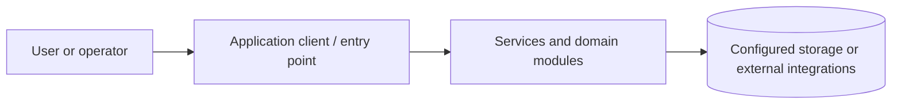

# Desktop Inventory & Invoicing | Electron, React, SQLite

Cross-platform desktop inventory management application with product records, invoices, reporting, account management, backup and restore, powered by Electron, React and SQLite.

**Explore this repository:** [Architecture](docs/ARCHITECTURE.md) · [Developer runbook](docs/RUNBOOK.md) · [Screenshot evidence guide](docs/SCREENSHOT_GUIDE.md) · [Audit](docs/PORTFOLIO_AUDIT.md)

**Discoverability topics:** `inventory-management` · `electron` · `react` · `sqlite` · `invoicing` · `desktop-app` · `reports`. These are suggested GitHub repository topics, not a claim that the repository settings have been updated.

> **Status:** Source-reviewed documentation draft. Runtime startup, end-to-end tests and screenshots have **not** been independently verified. Review PR before merging.

An Electron desktop application with React screens for inventory, invoices, accounts, users, reports and backup/restore. Source includes a SQLite database layer.

## Repository map

- `src/main/` — Electron main process and database.
- `src/renderer/` — React interface and feature components.
- `forge.config.js` and `webpack.*` — Electron Forge packaging and build configuration.

## Technology

Electron, React, better-sqlite3, Electron Forge, Chart.js, pdf-lib.

## Getting started

### Prerequisites

Install the runtime and tools relevant to this project (Node.js/npm, Python, .NET SDK, mobile SDK, or desktop runtime). Use the package manifest and lockfile to determine exact compatible versions. Obtain required databases and API credentials from your own provider accounts; never commit secrets.

### Install and run

`npm ci` then `npm start` to launch the desktop application. Use `npm run make` for distributable packages after validating native module compatibility. Desktop GUI required.

> These commands are derived from repository manifests, not confirmed by an end-to-end launch. If startup fails, inspect the relevant service's environment variables, dependency versions and logs.

## Architecture and data flow

This is a **conceptual overview**, not a verified deployment topology. The directory map above identifies the actual code areas to inspect for detailed component boundaries.

## Validation and troubleshooting

1. Confirm compatible runtime versions and install dependencies using the checked-in lockfiles.
2. Supply local environment variables through ignored files or a secrets manager.
3. Start required database, queue, mobile emulator or API dependencies.
4. Run scripts declared in the package manifests; record exit codes and failing commands.
5. Verify a complete user workflow with **non-sensitive demo data**.
6. Capture screenshots only after successfully launching the real application.

If you see a connection error, verify service endpoints and credentials without printing secrets. If a native build fails, verify platform SDK versions and native dependencies. Never treat a successful dependency installation as proof that the app works.

## Screenshots

**Not captured yet.** Genuine screenshots will be added under `docs/screenshots/` only after launching the application. Each screenshot will include its screen name, purpose, relevant workflow, capture platform and verification status. Do not substitute generated mockups for runtime evidence.

## Security and maintenance notes

Screenshots must be captured from the actual Electron window using demo data; native SQLite modules may require rebuilds.

Review dependency advisories, license terms, authorization boundaries, sensitive files and third-party integrations before public deployment.

## Contributing

Open an issue with a reproducible description. Work on a feature branch, keep changes focused, update tests and docs, and request review through a pull request. Do not include credentials, customer data or personal information in issues or screenshots.

## Documentation status

- [x] Purpose and source-derived architecture overview
- [x] Repository map and initial run instructions
- [x] Security and operational caveats
- [ ] Clean-environment startup verified
- [ ] End-to-end workflow tested
- [ ] Real screenshots captured and reviewed
- [ ] Production readiness assessed

For the detailed verification checklist see [docs/PORTFOLIO_AUDIT.md](docs/PORTFOLIO_AUDIT.md).
