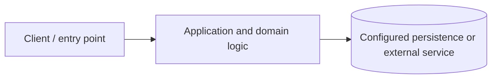

# Architecture and runtime verification

> **Source-based architecture notes.** No successful launch or end-to-end test has been observed in this review.

## System overview

Electron main process (`src/main`) -> preload bridge -> React renderer (`src/renderer`) -> database layer (`src/main/database.js`) -> local SQLite. Main/renderer boundary should restrict exposed IPC.

## Components and boundaries

- **Technologies observed:** Electron, React, SQLite.
- **Trust boundaries:** Treat external input as untrusted, validate at server-side entry points, restrict secrets to runtime configuration, and enforce authorization on protected operations.
- **Operational dependencies:** Inspect package manifests, application configuration and service connection code before choosing runtime versions or deployment settings.

## Architecture diagram

The diagram is intentionally high-level. It must not be interpreted as proof of the live production topology.

## Verification procedure

1. Check out this pull request branch into an isolated workspace.
2. Record OS, runtime versions, commit SHA and dependency install output.
3. Inspect environment variable names without copying values into logs or documentation.
4. Start required services and the application using commands in the root README.
5. Verify one successful workflow and one failure/recovery workflow using synthetic demo data.
6. Run available automated tests and report both failures and missing test scripts.
7. Capture genuine, redacted application screenshots and record the capture command, URL/window and commit.
8. Check for exposed credentials, private files, generated build outputs and license issues before merge.

## Known review concern

Review preload/IPC permissions and database backup locations.

## Evidence register

| Evidence | Current status |
|---|---|
| Source structure | Inspected |
| Installation and startup | Not verified |
| Functional workflows | Not verified |
| Automated tests | Not run |
| Runtime screenshots | Not captured |
| Production security readiness | Not assessed |

**Do not mark unverified steps as completed or replace screenshots with generated images.**
