# Screen gallery and user guide

This gallery covers every primary route declared in `src/renderer/App.jsx`, both report tabs, and the principal create/edit/detail dialogs: **18 real screenshots**. Native menu windows, OS file pickers, print dialogs and error/confirmation states are not presented as captured screens.

## Capture method and sample data

Captured on 14 November 2026 from the application’s actual React renderer, served by Electron Forge. A temporary loopback-only review adapter connected that renderer to the same real Electron IPC database handlers and a fresh local SQLite database. No mock API responses, fabricated screens or production records were used. The adapter is not included in the repository or needed to run the desktop app. Native Windows window capture failed, so these images are renderer screenshots rather than desktop-window captures.

The app’s built-in product/customer seeds supplied sample records. A demonstration sale with reference `DEMO-GALLERY-001` was saved through the UI: **2 × ₨400 = ₨800**. Its history, details, customer report, item report and dashboard were checked against the saved result.

## Everyday workflow

1. Sign in to the desktop app.
2. Review or maintain Products and Customers.
3. Open Sale Invoice → New Invoice.
4. Select an item and customer, enter quantity/rate, and confirm each row with its green check.
5. Save Invoice, then verify it in invoice history and View Details.
6. Open Report to inspect customer and item summaries for the invoice date.
7. Use native backup controls before operational changes; restore only a verified backup into a suitable environment.

## Screens

### Sign in

**Purpose:** Authenticate a local user before entering the application.

**Use:** Enter the locally configured username and password, then choose Sign In. The demonstration used the project’s seeded development administrator; change legacy defaults before operational use.

**Location:** `/ (signed out)`

### Dashboard

**Purpose:** See product/customer counts, invoice count, total sales, charts and recent invoices.

**Use:** Review the summary cards and recent invoices. The example shows 6 seeded products, 3 seeded customers, 1 demonstration invoice and ₨800 sales. Reload the application if summary cards are stale after a sale.

**Location:** `/`

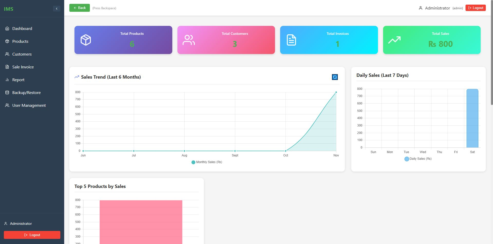

### Products

**Purpose:** Maintain the item catalog used when preparing invoices.

**Use:** Search existing items by name or code. Review item codes, English/Urdu names and prices; select New Product or Edit to open the relevant form.

**Location:** `/products`

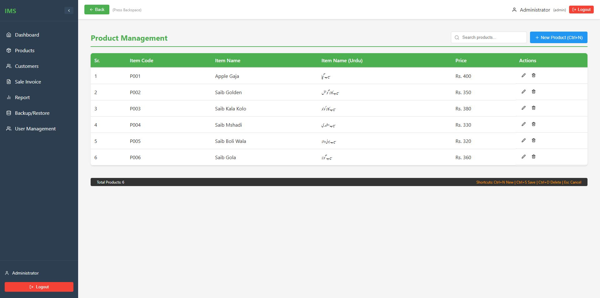

### New product form

**Purpose:** Define a new catalog item.

**Use:** Enter a unique item code, required name, optional Urdu name and price. Save adds the item; Cancel returns without saving. This capture shows the form only; creation was not exercised in this walkthrough.

**Location:** `/products (new form)`

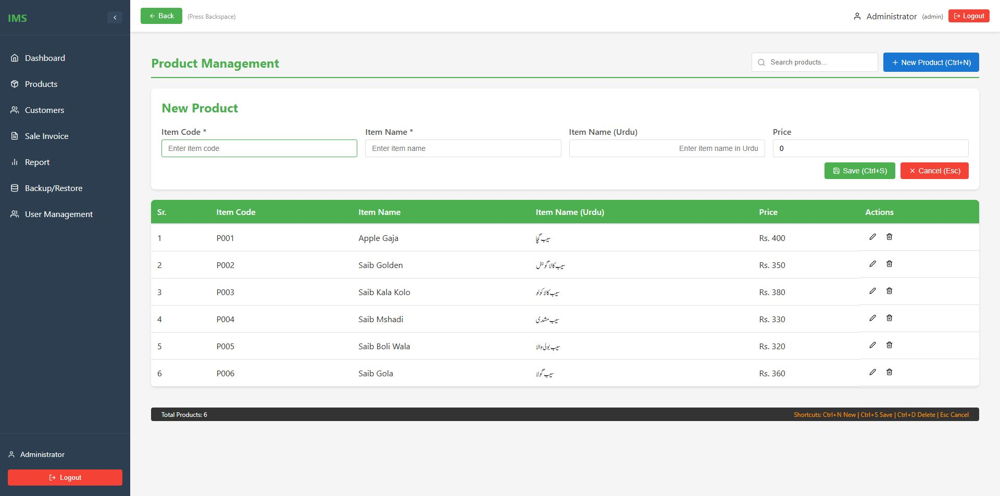

### Edit product form

**Purpose:** Update an existing catalog item.

**Use:** Choose Edit on a product row, change the required fields, then Save. The captured seeded product was opened and canceled without changing it.

**Location:** `/products (edit form)`

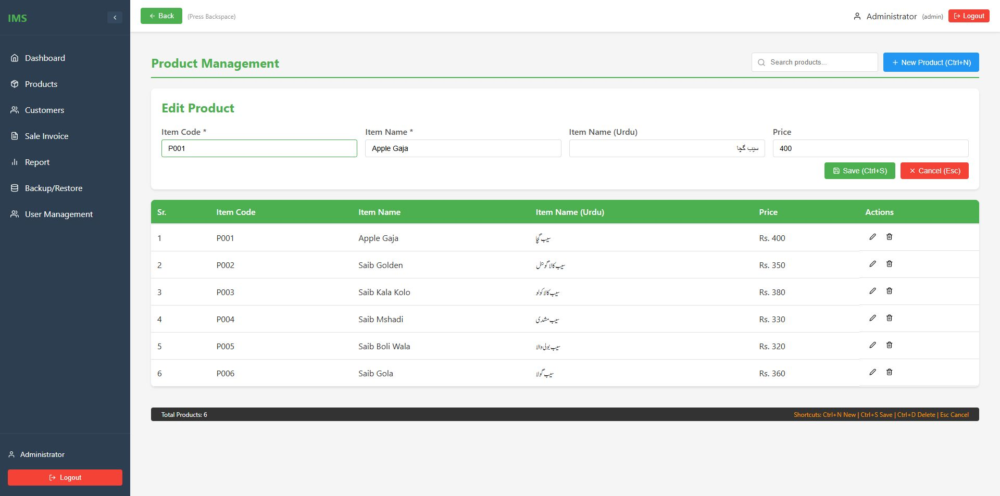

### Customer accounts

**Purpose:** Keep customer identities and account contact information for invoice assignment.

**Use:** Search by English/Urdu name or mobile number. Select New Account or Edit Account. Names and numbers here come from the repository’s built-in sample records.

**Location:** `/accounts`

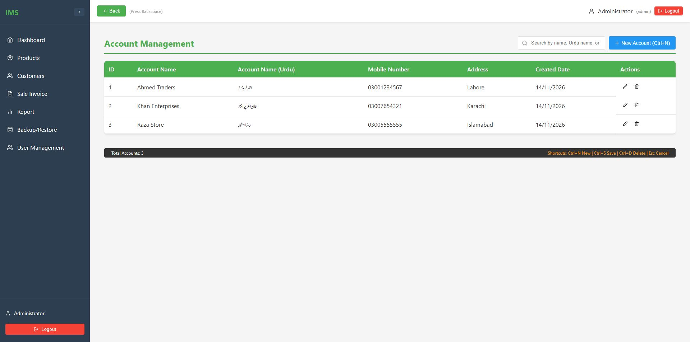

### New customer form

**Purpose:** Create an account that can be selected on sales invoice rows.

**Use:** Enter the account name, optional Urdu name, mobile number and address, then Save. This walkthrough opened the form and canceled it.

**Location:** `/accounts (new form)`

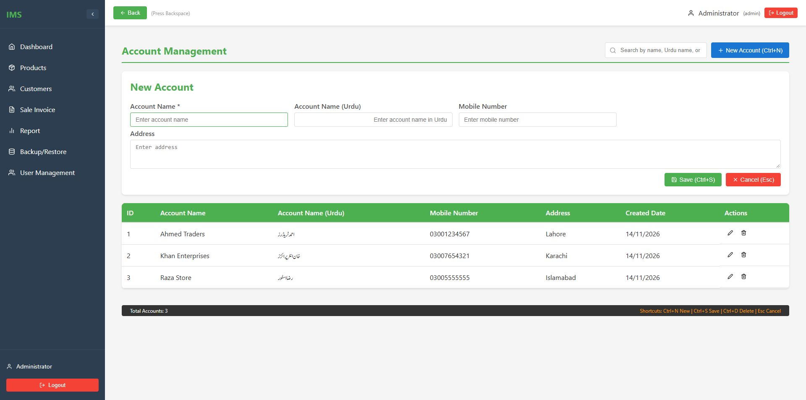

### Edit customer form

**Purpose:** Maintain an existing customer account.

**Use:** Select Edit Account, adjust the account fields and save when appropriate. The screenshot shows a seeded account; no contact details were changed.

**Location:** `/accounts (edit form)`

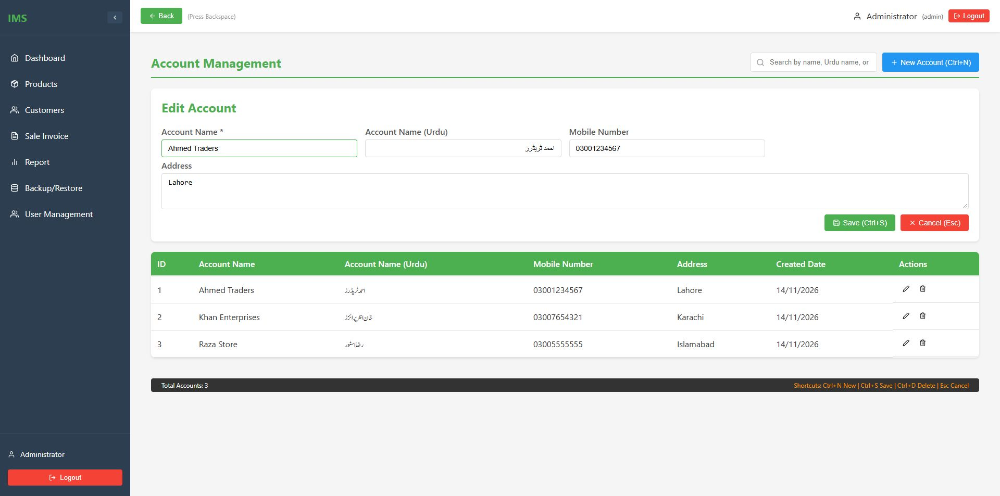

### New sales invoice

**Purpose:** Prepare a sale using catalog items and assigned customers.

**Use:** Set the date/reference, select an item and customer, enter quantity and rate, then confirm the row with its green check control. Use Save Invoice to persist valid rows. A blank edit row can remain for the next item.

**Location:** `/invoices/new`

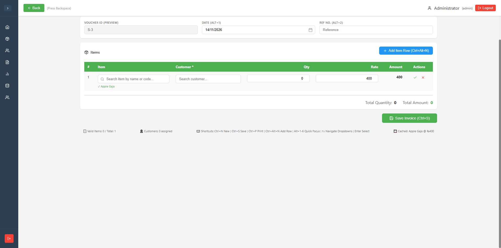

### Invoice history

**Purpose:** Find and manage saved sales invoices.

**Use:** Filter by date and search voucher/reference values. Edit reopens the invoice; View Details shows the saved breakdown. The sample DEMO-GALLERY-001 invoice persisted successfully.

**Location:** `/invoices`

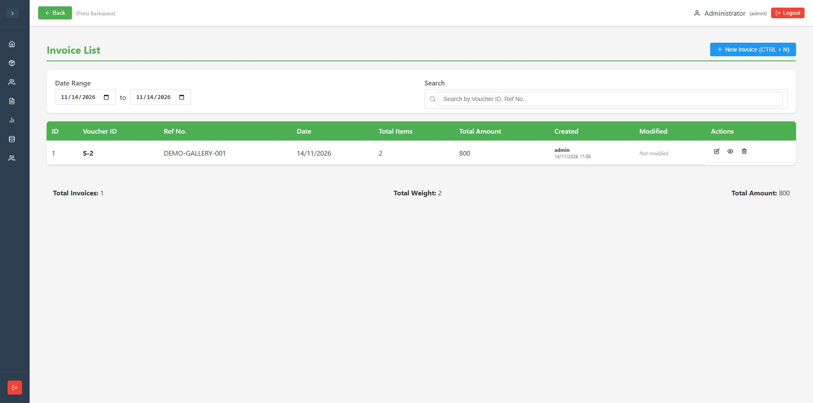

### Invoice details

**Purpose:** Inspect the saved customer/item breakdown and totals.

**Use:** Choose View Details on a saved invoice. This example contains Apple Gaja, quantity 2 × rate ₨400 = ₨800, with zero discount and ₨800 net amount.

**Location:** `/invoices (details dialog)`

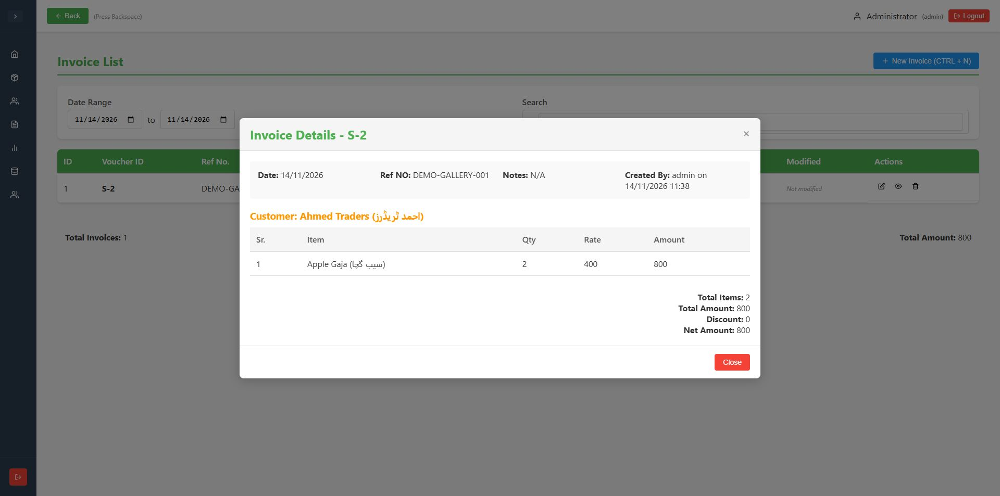

### Edit invoice

**Purpose:** Load a saved invoice into the entry screen for correction.

**Use:** Choose Edit in invoice history, review the original voucher, rows and totals, then Update Invoice or Cancel Edit. Loading was verified; modifying an existing saved invoice was not exercised.

**Location:** `/invoices/edit`

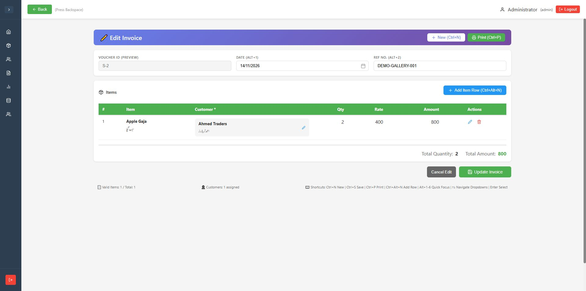

### Customer sales summary

**Purpose:** Summarize the selected day’s sales by customer.

**Use:** Choose Customer Summary, select a date and optionally search a customer. The verified sample appears under Ahmed Traders with a grand total of ₨800. Print controls are available in the native app but were not invoked.

**Location:** `/reports (customer tab)`

### Item sales summary

**Purpose:** Summarize quantities and amounts for each sold item.

**Use:** Choose Item Summary, set the date and optionally search by item. The verified sample shows quantity 2 and amount ₨800 for Apple Gaja.

**Location:** `/reports (item tab)`

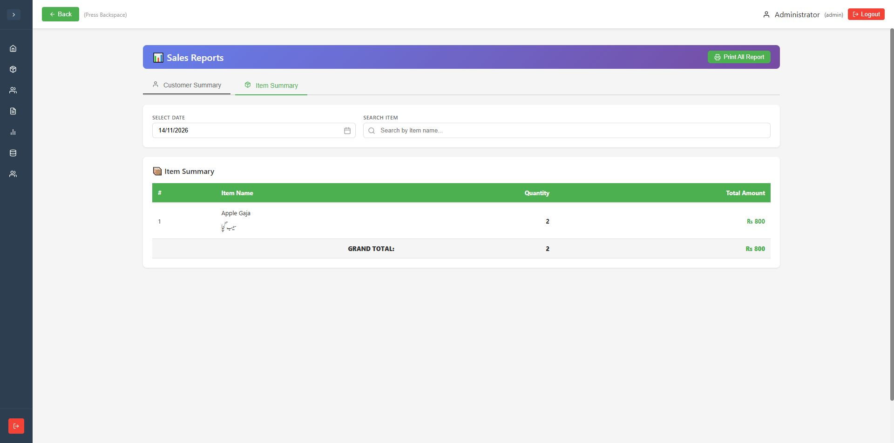

### Backup and restore

**Purpose:** Expose the native controls for copying or restoring the SQLite database.

**Use:** Backup Now opens the native save workflow; Restore selects a backup and replaces the active database. Only the page was inspected—no backup/restore or overwrite was performed. The current main-process source stores inventory.db beside the executable, despite the page footer saying App Data.

**Location:** `/backup`

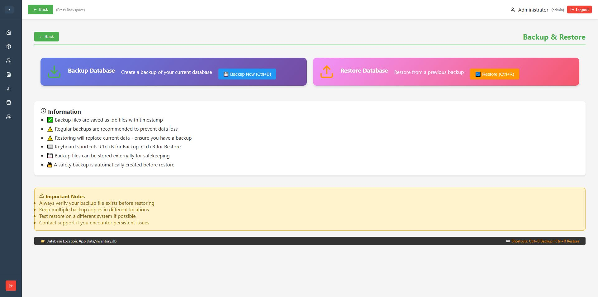

### User management

**Purpose:** Let administrators inspect local users and roles.

**Use:** Review the user table and role counts, refresh the list, open Add New User or Change Password. The sample database contains one administrator.

**Location:** `/user-management`

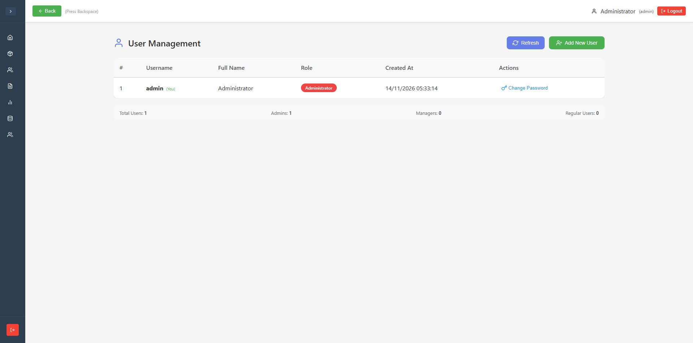

### Add user dialog

**Purpose:** Prepare a local user with User, Manager or Admin role.

**Use:** Enter a username, password, optional full name and role, then Create User. This walkthrough captured the empty dialog and canceled; it did not create accounts.

**Location:** `/user-management (new user dialog)`

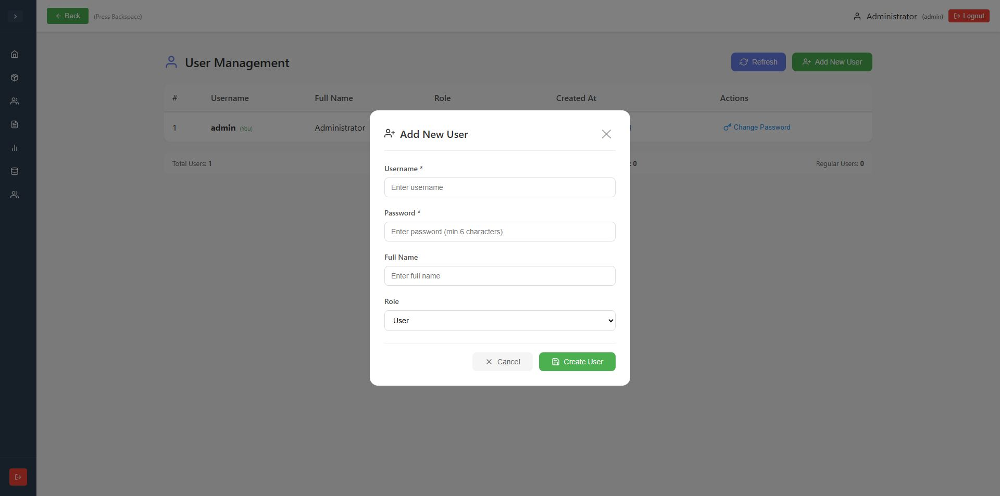

### Change password dialog

**Purpose:** Expose the password-change form for a selected local user.

**Use:** Enter and confirm a new password, then Update Password when authorized. Only the blank dialog was captured; no password was entered or changed.

**Location:** `/user-management (password dialog)`

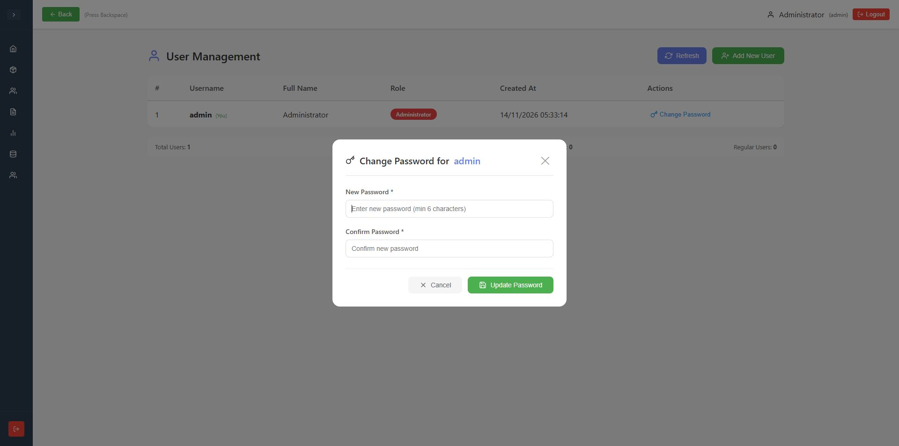

## Validation boundaries and observations

- Verified: local seeded login; route navigation; populated product/customer lists; create/edit form opening; saving one sample invoice; reloading its persisted details and invoice edit screen; customer and item report totals; dashboard totals after reload.
- Form opening is not a claim that every create/update/delete action was exercised. No users, passwords, seed product prices or seed account contacts were changed.
- Native backup/restore, PDF generation, printing, installer output and OS dialogs were not tested. The review adapter deliberately did not expose these native operations.
- Observed refresh behavior: dashboard summary cards did not refresh merely by returning from invoice entry; reloading showed the saved sale. During new invoice entry, row amounts updated before the footer totals; saved invoice details/reports were checked instead. These remain follow-up UI issues.
- Fixed startup blocker: initialized webpack asset-relocator cache so native SQLite resolves instead of producing an undefined native-binding path. Development startup and SQLite login/save/read worked afterward. Packaged installer behavior is unverified. [Electron Forge native-module guidance](https://www.electronforge.io/config/plugins/webpack).
- Legacy authentication stores local passwords without modern hashing, and renderer role checks are not a complete security boundary. Do not treat this walkthrough as production security approval.
